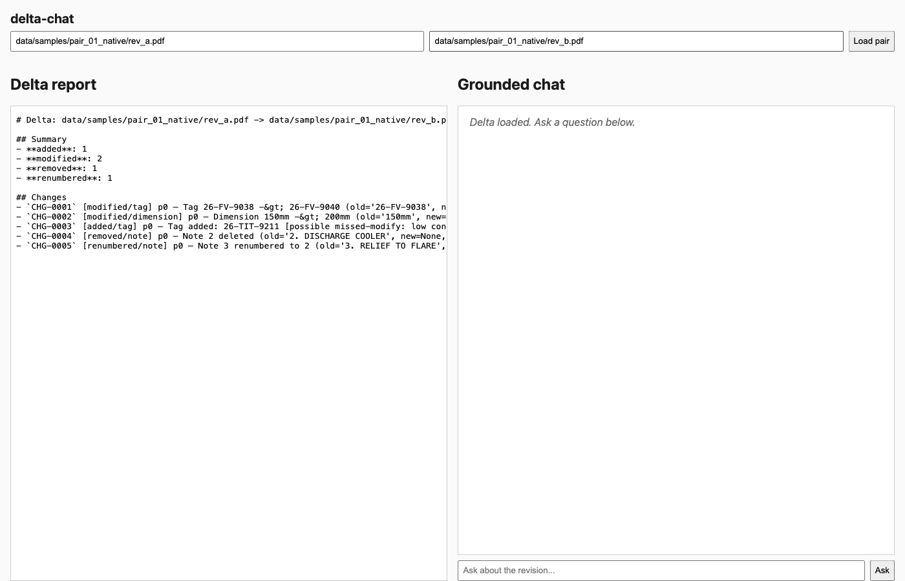
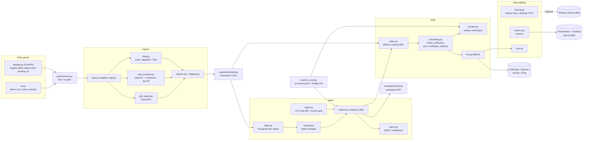

# delta-chat

Compares two revisions of a P&ID drawing (native PDF, scanned PDF, or DXF), reports what changed as a
typed delta, and answers questions about the changes with citations, for engineers reviewing drawing
revisions.

## Demo

Video walkthrough (Loom, about 5 minutes): https://www.loom.com/share/b3a3036a75dd49f9a3409b997741cee5



## What it does

- Ingests both revisions into one canonical `Document`/`Item` model, whatever the input format:
  native PDF (PyMuPDF), scanned PDF (OpenCV preprocessing + Tesseract, with docTR as an optional
  engine), or DXF (ezdxf). `.dwg` is converted to DXF when `dwg2dxf` or the ODA File Converter is on
  the PATH; otherwise the adapter returns a "conversion required" status.
- Tags instruments, equipment and line numbers with configurable ISA-5.1 style regexes.
- Computes a deterministic delta: `added`, `removed`, `modified`, `moved` and `renumbered` changes,
  each with two confidence scores (`match_conf` for alignment, `class_conf` for classification).
- Writes the delta as `report.json` and `report.md`, plus a best-effort annotated PDF overlay.
- Answers questions over the delta and both documents. Each answer is `Grounded`, `Partial` or
  `Rejected`; every claim must cite a source id that resolves, and the system abstains when the
  retrieved evidence is not sufficient.
- Exposes the same pipeline over a FastAPI service with a small web UI at `/ui`.
- Writes a JSON trace file per run, exposes Prometheus metrics at `/metrics`, and can optionally
  export OpenTelemetry spans to Phoenix.
- Includes an evaluation pipeline that scores delta, chat, retrieval and OCR quality and gates CI on the
  deterministic metrics.

## Architecture



Design choices and their tradeoffs:

- **One canonical model between ingestion and everything else.** Every adapter produces the same
  `Document`/`Item` types, so the delta engine, retrieval and eval code have no per-format branches.
  The cost is that anything a format carries beyond text, position and type is dropped.
- **Deterministic delta, no LLM in the default path.** Items are aligned with a Hungarian assignment
  (`scipy.optimize.linear_sum_assignment`) per drawing region, scored on text, spatial, type and
  region similarity, then classified by rules. Changes are sorted before ids are assigned, so the
  same input gives byte-identical JSON. The note gate can call an LLM for ambiguous rewords, but its
  band is collapsed to a single cutoff (`semantic_low == semantic_high == 0.90` in
  `config/default.yaml`), so in practice the delta never calls a model. That trades away the
  cosmetic-versus-meaningful distinction a calibrated band would give.
- **Two confidence scores per change.** `match_conf` and `class_conf` are kept separate so a caller
  can tell "matched the wrong item" from "matched correctly but unsure of the type". Nothing filters
  on them by default.
- **BM25 instead of a vector database.** Retrieval runs over one pair's chunks (tens to low hundreds),
  so BM25 with an optional hybrid mode (BM25 fused via RRF with a term-frequency cosine score, no
  model download) is enough. Retrieval quality is currently low, see the baseline numbers below.
- **Two grounding paths, chosen by config.** `chat.grounding: json` (provider-agnostic structured
  output, the default) or `anthropic_citations` (Anthropic Citations API). They are not combined in
  one request.
- **Abstain before answering.** `check_sufficiency` first requires the best chunk to cover at least
  `coverage_min` of the query terms (pure code), then asks the model a yes/no "is this enough to
  answer" question. After generation, each claim is checked against its cited span with a
  rapidfuzz `partial_ratio` threshold, a lexical stand-in for entailment.

## Stack

- Python 3.11+, managed with uv (`pyproject.toml`, `uv.lock`)
- Ingestion: PyMuPDF, pytesseract (Tesseract), opencv-python-headless, ezdxf; optional python-doctr
- Delta: numpy, scipy, rapidfuzz
- Chat: rank-bm25, litellm, tiktoken
- Serving: FastAPI, uvicorn
- Observability: OpenTelemetry SDK + OTLP exporter, prometheus-client, structlog
- Eval extras (optional): ragas, deepeval
- Tests: pytest, pytest-cov, httpx
- Docker and Docker Compose; optional Phoenix, Prometheus and Grafana under the `obs` profile
- CI: GitHub Actions (tests with coverage gate, gitleaks secret scan, offline eval gate)

## Run it locally

Prerequisites: [uv](https://docs.astral.sh/uv/), Python 3.11+, and Tesseract for scanned PDFs
(`brew install tesseract` or `apt-get install tesseract-ocr`).

```bash
make install    # uv sync, copy .env.example to .env if missing, generate sample pairs
make run        # ingest the default pair, write report.json/report.md (+ markup.pdf) to data/output/<id>/
make demo       # run, then an interactive grounded chat in the terminal
make chat       # interactive grounded chat over a pair
make markup     # write an annotated PDF of the delta to ./markup.pdf
make eval       # offline eval: scorecard.json + budget.md, non-zero exit on regression
make test       # pytest suite
```

Use another pair with `PID_A=path/to/a.pdf PID_B=path/to/b.pdf make run` (bare paths or `file://`
URIs). The default pair is `data/samples/pair_01_native/`. Sample pairs are generated by
`scripts/synth_samples.py` and are not committed.

With the CLI directly, a one-shot question instead of the interactive loop:

```bash
PYTHONPATH=src uv run delta-chat demo \
  --pid-a data/samples/pair_01_native/rev_a.pdf \
  --pid-b data/samples/pair_01_native/rev_b.pdf \
  --query "what changed about the setpoint?"
```

Docker:

```bash
make up         # app on :8000 (web UI at http://localhost:8000/ui, /healthz, /metrics)
make up-obs     # adds Phoenix :6006, Prometheus :9090, Grafana :3000
make down
```

The compose file uses the optional `env_file` form, which needs Docker Compose v2.24 or newer.

**Keys.** Ingestion, delta, reports, markup, retrieval, `make eval` and `make test` need no API key.
Chat answers need one LLM provider, read from the environment (see `.env.example`):

| Variable | Purpose |
|---|---|
| `ANTHROPIC_API_KEY` | Anthropic (default model `claude-sonnet-5` in `config/default.yaml`) |
| `OPENAI_API_KEY` | OpenAI |
| `GEMINI_API_KEY` | Gemini |
| `LOCAL_LLM_BASE_URL` | Ollama or vLLM OpenAI-compatible endpoint, no key |

`llm.provider: auto` picks the first present in the order anthropic, openai, gemini, local. Any
config value can be overridden with `DELTA_CHAT__<SECTION>__<KEY>`, for example
`DELTA_CHAT__LLM__MODEL=gemini-2.0-flash`. Note that the default eval judge is `gpt-4o-mini`, so a
live (non-offline) eval run needs an OpenAI key as well.

## Tests and evaluation

```bash
make test       # uv run pytest -m "not llm"
make eval       # python -m eval.run_eval --offline --baseline eval/baseline_scorecard.json
```

The suite has 234 test functions across 31 files (counted with
`git grep -c -E "^\s*(async )?def test_" -- tests`). Tests marked `slow` need Tesseract. 10 tests parse the original
source drawings and skip without them; those drawings are not redistributed, so the tests run
only if the files are placed in `data/samples/source/`. CI runs the
suite with an 80% coverage floor on `canonical`, `ingest`, `delta` and `eval`.

`make eval` runs the real ingest, delta and BM25 retrieval, but replaces chat generation and the
judge with a deterministic stub (`--offline`). Only the `deterministic` block is gated against
`eval/baseline_scorecard.json`: delta F1 on the test split, citation validity, p95 latency and cost
per request. Model-graded metrics are reported but never gated. Drop `--offline` for a run against
a live model.

The gold data is five synthesized revision pairs with logged edits (`data/samples/provenance.md`):
`pair_01_native` is the train split, the other four are the test split. Gold sets are small: 17
delta records and 12 Q&A items (`wc -l eval/datasets/*.jsonl`).

Baseline numbers from `eval/baseline_scorecard.json` (test split):

| Metric | Value |
|---|---|
| Delta precision / recall / F1 at tau 0.5 | 0.476 / 0.833 / 0.606 |
| Gated `delta_f1_test` | 0.545 |
| `pair_04_multisheet` F1 | 0.0 (the sheet-3 edit is missed) |
| Citation validity | 1.0 |
| Abstention precision / recall (offline) | 1.0 / 0.667 |
| Retrieval hit rate at k = 3, 5, 10 | 0.111 (9 queries; 0.0 at k = 1) |
| OCR WER / CER on `pair_03_scanned` | 0.385 / 0.366 (depends on the installed Tesseract) |

The offline chat numbers (faithfulness 1.0 and similar) come from the stub and say nothing about a
real model.

## Known limitations

- **Low delta precision.** About half the reported changes on the test split are false positives,
  mostly spurious `added` changes. Filtering low-`match_conf` adds and removes is the obvious next
  step.
- **Multi-sheet changes can be missed.** The sheet-3 edit in `pair_04_multisheet` produces no change.
- **Note gate is not calibrated.** No calibration script exists; the gate is a fixed cosine cutoff
  over a hashed embedding, not a learned model.
- **Offline abstention recall is 0.67.** The lexical coverage floor cannot separate every
  unanswerable question on sparse P&ID text; the LLM sufficiency check is meant to close that gap
  but is not exercised in CI.
- **Judge agreement is unmeasured.** `eval/judge.py` enforces a different model family from the
  answerer, swaps answer order in pairwise prompts, and implements `cohen_kappa()`, but there is no
  human-labelled set, so kappa has never been computed.
- **No connectivity-graph delta.** Changes are found from text and coarse geometry, not from traced
  piping and instrument connections.
- **DWG support is DXF-level.** Real `.dwg` needs an external converter; the Docker image does not
  install one.
- **In-memory API state.** The API keeps ingested pairs and deltas in a process-local dict, so they
  are lost on restart.

## Project layout

```
src/delta_chat/
  api/            FastAPI app and the static web UI (web/)
  canonical/      Document, Item, Change and Delta types shared by every stage
  chat/           retrieval index, sufficiency gate, grounding, answer verification, LLM client
  delta/          alignment, classification, note diff, delta engine, report rendering
  ingest/         format adapters: native PDF, scanned PDF + OCR, DXF/DWG; region and tag extraction
  markup/         annotated PDF overlay of a delta
  observability/  tracing, Prometheus metrics, structured logging, token cost
  pids/           resolves pid strings (paths, file:// URIs) to bytes
  cli.py          delta-chat CLI entry point
  config.py       YAML config loader with env overrides
eval/             eval runner, metrics, judge, gold datasets, committed baseline scorecard
scripts/          synth_samples.py: builds revision pairs and gold data
config/           default.yaml (all thresholds and model ids), prometheus.yml
data/samples/     per-pair metadata, provenance notes
tests/            pytest suite, mirrors the src/ and eval/ layout
```

More detail on the walkthrough commands and expected output: [DEMO.md](DEMO.md).
